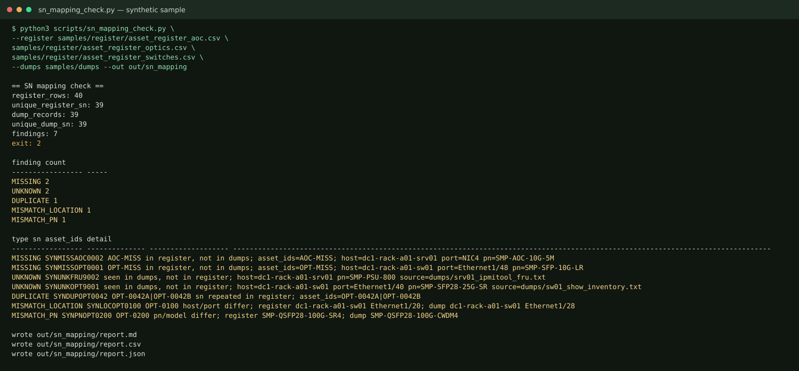

# DC Inspection & Asset Register Kit — Free Lite

## English

Free subset of the DC Inspection & Asset Register Kit. It has the bilingual daily inspection checklist and the serial-number checker. The checker reads a synthetic AOC, optics, and switch register and compares it with Cisco-style `show inventory`, `ipmitool fru print`, and `lshw -json`.

Manual reconciliation of those three classes is easy to get wrong. This lite repo flags MISSING, UNKNOWN, DUPLICATE, MISMATCH_LOCATION, and MISMATCH_PN. Serials are stripped and uppercased before compare. Python 3 standard library only. No workbook and no snapshot reconcile in this preview.

The sample is synthetic. It is supposed to exit 2.

### Quick start

```bash
python3 scripts/sn_mapping_check.py \
  --register samples/register/asset_register_aoc.csv \
    samples/register/asset_register_optics.csv \
    samples/register/asset_register_switches.csv \
  --dumps samples/dumps \
  --out out/sn_mapping
```

Reports land in `out/sn_mapping/` (`report.md`, `report.csv`, `report.json`). `out/` is gitignored. The captured stdout is [docs/demo_output.txt](docs/demo_output.txt).

```bash
python3 -m unittest discover -s tests
```

The checklist is `checklists/daily_inspection_checklist.md` and `checklists/daily_inspection_checklist.csv` (OK, NG, Severity, Remark). The NG summary script is in the full pack.

### Demo



### Full pack deliverables

The full kit is a separate download. This repo does not include it.

- Bilingual daily inspection checklist (Markdown and CSV) — also in this lite repo
- AOC, optics (SFP through QSFP-DD), and switch register templates
- `asset_register.xlsx` (styled header, frozen panes, status dropdown)
- Inspection NG summary by area and severity
- Dump parsers and the SN mapping check — also in this lite repo
- Snapshot reconcile: added, removed, moved, status changed
- 40-row synthetic sample, filled checklist, and two snapshots
- `demo.py`, unit tests, acceptance script, and setup notes

### Delivery time

Full kit: instant download. Setup about 10 minutes. Adapting the templates to your own register about 30 minutes.

This lite repo: clone and run the command above. The sample check finishes in seconds.

### Links

Full kit on Gumroad: https://caoyadong.gumroad.com/l/hxlops

Pay what you want, $1 or more. Suggested price is $5.

Full n8n DevOps pack, $9: https://caoyadong.gumroad.com/l/yvmcqj

### License

MIT. Copyright (c) 2026 caoyadong888-wq. See [LICENSE](LICENSE).

## 中文

这是「数据中心巡检与资产台账」的免费精简版。含中英每日巡检表，以及序列号比对脚本。脚本读取合成的 AOC、光模块、交换机台账，对照 Cisco 风格的 `show inventory`、`ipmitool fru print` 和 `lshw -json`。

手工核对这三类资产很容易出错。精简版会标出 MISSING、UNKNOWN、DUPLICATE、MISMATCH_LOCATION、MISMATCH_PN。序列号先去掉空白再转成大写。只用 Python 3 标准库。本预览不含工作簿，也不含快照对账。

示例是合成数据，退出码应为 2。

### 快速开始

```bash
python3 scripts/sn_mapping_check.py \
  --register samples/register/asset_register_aoc.csv \
    samples/register/asset_register_optics.csv \
    samples/register/asset_register_switches.csv \
  --dumps samples/dumps \
  --out out/sn_mapping
```

报告写到 `out/sn_mapping/`。`out/` 已被忽略。同一次运行的标准输出在 [docs/demo_output.txt](docs/demo_output.txt)。

```bash
python3 -m unittest discover -s tests
```

巡检表是 `checklists/daily_inspection_checklist.md` 和 `checklists/daily_inspection_checklist.csv`。NG 汇总脚本在完整包里。

### 演示


### 完整包交付物

完整包单独下载。本仓库不含这些额外文件。

- 中英每日巡检表（Markdown 和 CSV）— 本精简版已含
- AOC、光模块（SFP 到 QSFP-DD）、交换机台账模板
- `asset_register.xlsx`（表头样式、冻结窗格、状态下拉）
- 按区域和严重级别汇总的巡检 NG
- 采集解析和序列号比对 — 本精简版已含
- 快照对账：新增、删除、移动、状态变化
- 40 行合成示例、已填写的巡检表、两份快照
- `demo.py`、单元测试、验收脚本和安装说明

### 交付时间

完整包：下载即得。安装并跑通大约 10 分钟。把模板改成自己的台账大约 30 分钟。

本精简版：克隆后运行上面的命令即可。示例比对几秒内结束。

### 链接

完整包 Gumroad：https://caoyadong.gumroad.com/l/hxlops

愿付多少付多少，1 美元起，建议 5 美元。

完整 n8n DevOps 包，9 美元：https://caoyadong.gumroad.com/l/yvmcqj

### 许可证

MIT。Copyright (c) 2026 caoyadong888-wq。见 [LICENSE](LICENSE)。
